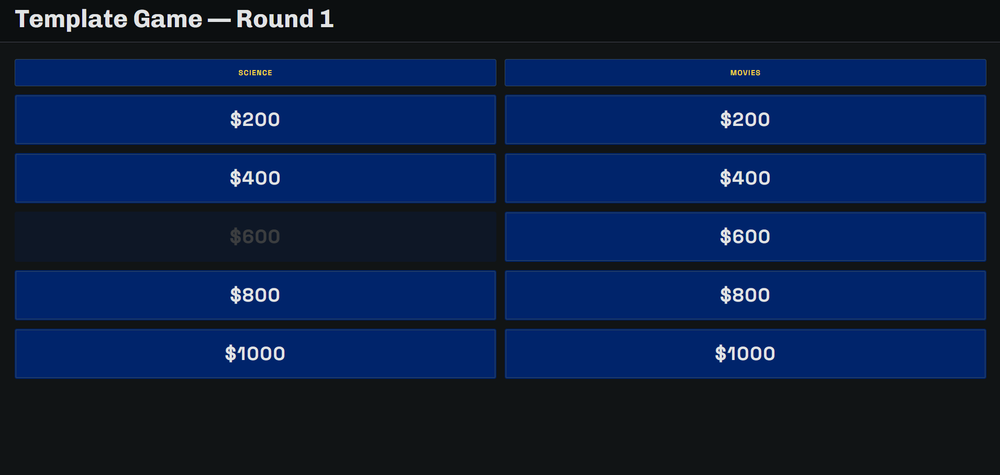
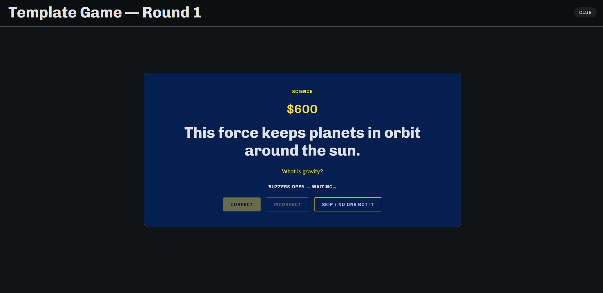
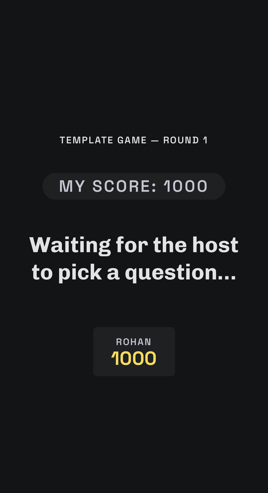
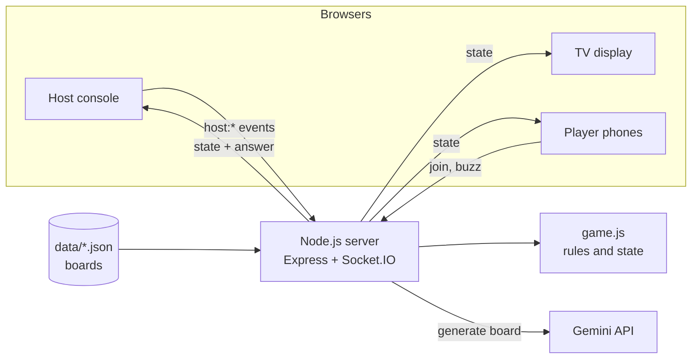

# Jeopardy Party Game

[](https://github.com/RohanPlimbachia/jeopardy-game/actions/workflows/test.yml)

A multiplayer Jeopardy game for game nights. The board plays on a TV, the host runs the game from a laptop, and everyone buzzes in from their phone. It runs on your own Wi-Fi network, so there's no account, app install or internet connection needed (except for the optional AI board generator).



| Host console | Player buzzer |
|---|---|
|  |  |

## Features

- **Three screens, one game.** A shared display for the TV, a host console with the answers, and a phone buzzer for each player. They all stay in sync in real time over WebSockets.
- **Fair buzzing.** The server decides who buzzed first. A player who answers wrong is locked out of that clue, and the buzzer reopens for everyone else.
- **Answers stay secret.** Answers are only ever sent to the host's screen. Players and the TV never receive them, even in the browser's dev tools.
- **Survives refreshes.** If a phone locks or a player refreshes, they rejoin with their score.
- **Boards are data, not code.** Each board is a JSON file in `data/`. Copy `data/sample-game.json` to make your own.
- **AI board generator.** Type a topic and Gemini writes a full board (5 categories × 5 clues, correct dollar values) using a JSON schema, so the result always loads.
- **Multiple rounds.** Move from Round 1 to Double Jeopardy to Final Jeopardy and scores carry over.
- **Optional host PIN** so other people on the same Wi-Fi can't open the host screen.

## Quick start

Needs [Node.js](https://nodejs.org) 22.9 or newer.

```bash
git clone https://github.com/RohanPlimbachia/jeopardy-game.git
cd jeopardy-game
npm install
cp .env.example .env   # optional: add a Gemini key or a host PIN
npm start
```

The server prints three links:

```
Host controls:  http://localhost:3000/host
Shared display: http://localhost:3000/display
Players join:   http://192.168.1.25:3000/
```

Open the display on the TV, the host console on your laptop, and have players open the last link on their phones (they need to be on the same Wi-Fi).

## How it works



- **The server is the single source of truth.** Browsers send *intents* ("I buzzed", "mark that correct") and the server applies the rules, then sends each screen its own view of the state. Nothing a client sends can change a score directly.
- **Game rules live in `game.js`**, separate from the networking in `server.js`. That keeps the rules easy to read and lets them be unit-tested without a server.
- **Host commands are checked on the server.** A `host:*` event is ignored unless it comes from a connection that joined as host (with the PIN, if one is set).
- **Boards are validated when loaded**, whether they come from a file or from the AI, so a bad board is skipped with a clear message instead of crashing a game.

| File | What it does |
|---|---|
| `server.js` | HTTP routes, Socket.IO events, host checks, loading boards |
| `game.js` | Game rules: joining, buzzing, scoring, rounds, what each screen may see |
| `ai.js` | Builds the prompt and calls Gemini with a JSON response schema |
| `public/` | The three screens (`host.html`, `display.html`, `play.html`) and shared rendering code |
| `data/` | Board files |
| `test/` | Jest tests for the game rules |
| `DESIGN.md` | The visual design system (colours, type, components) |

## Making your own board

Copy `data/sample-game.json`, rename it, and edit the categories and clues. The file explains every field. Restart the server and the new board shows up in the host's game picker.

## Tests

```bash
npm test
```

The tests cover buzz order and lockouts, scoring, rounds, reconnecting players, board validation, and the rule that only the host can see answers. They run on every push with GitHub Actions.

## Configuration

All optional, set in `.env`:

| Variable | Purpose |
|---|---|
| `GEMINI_API_KEY` | Turns on the AI board generator ([free key](https://aistudio.google.com/apikey)) |
| `HOST_PIN` | Requires a PIN to open the host screen |
| `PARTY_MODE` | `true` gives AI-generated Round 2 boards an adults-only tone |
| `PORT` | Defaults to 3000 |

## Built with

Node.js, Express, Socket.IO, vanilla JavaScript, Jest, and the Gemini API. Built with [Claude Code](https://claude.com/claude-code) as a coding assistant: I wrote the specs, and reviewed and tested the code.

## Roadmap

- [ ] Daily Doubles and wagering for Final Jeopardy
- [ ] Room codes so several games can run on one server
- [ ] Board editor in the host console

## License

MIT
